  
  
  
  

  <a href="https://inmark.ai/">Inmark AI</a> ·
  <a href="https://orchi.prathamshrestha69.com.np/">Ochi Clone</a> ·
  <a href="https://e-commerce-omega-taupe-84.vercel.app/">E-commerce</a> ·
  <a href="https://gdg-hackathon-frontend.vercel.app/">Interview AI</a> ·
  <a href="https://www.susanshrestha404.com.np/">Susan Portfolio</a>

  

  

  
  

  

