  
  
  
  

> A passionate Full-Stack developer who loves building smooth, interactive, and visually clean web experiences. I'm especially into micro-interactions and scroll-based animations that make interfaces feel alive.

  

  
  &nbsp;Next.js · GSAP &amp; motion · 3D on the web

  <a href="https://inmark.ai/">inmark-ai</a> ·
  <a href="https://sports-web-two-orcin.vercel.app/">sports-web</a> ·
  <a href="https://sunrise-dental-ashy.vercel.app/">sunrise-dental</a> ·
  <a href="https://blackfire-studio.vercel.app/">blackfire-studio</a> ·
  <a href="https://e-commerce-omega-taupe-84.vercel.app/">e-commerce</a>

  

  

  
  

  

